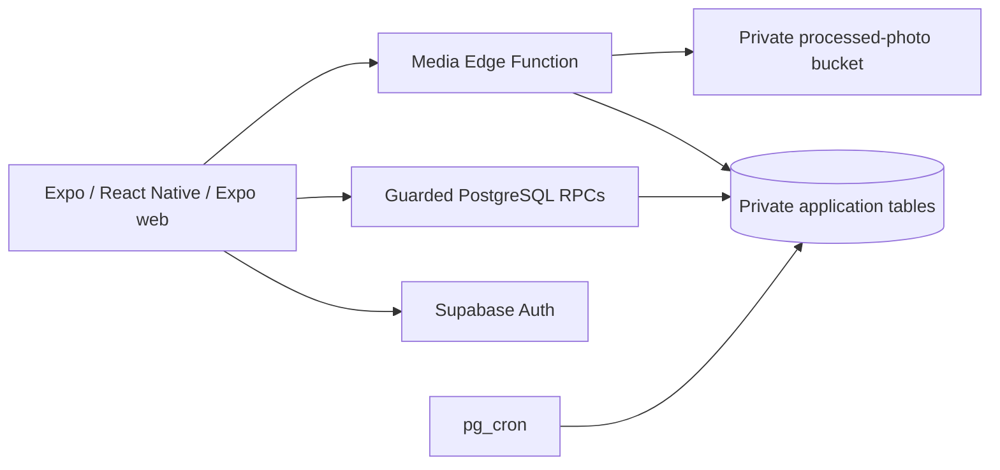
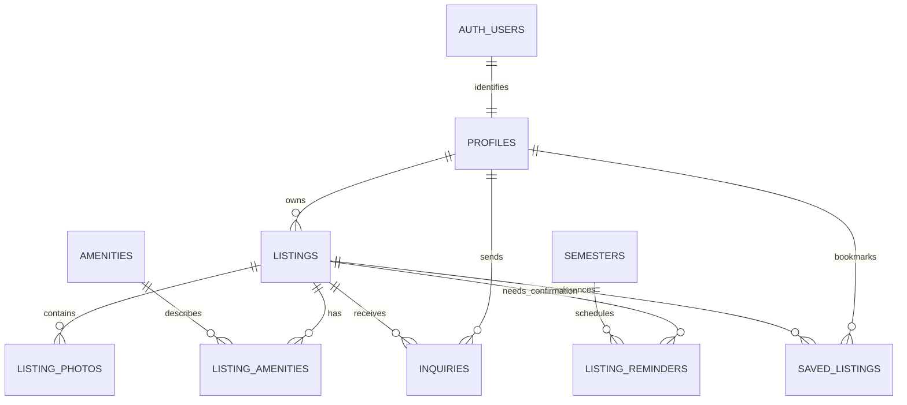

# Tinir — Technical Requirements Document (TRD)

| | |
|---|---|
| **Product** | Tinir |
| **Version** | 0.3 |
| **Date** | 2026-11-07 |
| **Status** | Expo + Supabase backend architecture selected by the user; local implementation. Feature screens and hosted deployment remain separate work. |
| **Related** | [PRD](PRD.md) · [Requirements](REQUIREMENTS.md) · [Backend setup](BACKEND.md) |

## 1. Purpose and Delivery Scope

Provide backend support for FR1–FR14 and the server-side controls in NFR3–NFR9, preserving the source backlog’s priorities and Sprint 1–5 schedule. Supabase supplies PostgreSQL, Auth, Storage, scheduled database jobs, and Edge Functions; Expo/React Native with Expo Router remains the client. A separate Next.js or Express server is not part of this architecture.

This supersedes the earlier draft’s proposed Next.js handlers, ORM, custom password tables, and cookie-only session model. It does not change the product baseline, require a PWA, or claim that backend tests complete UI, usability, browser, native-device, production performance, or operational acceptance.

## 2. Architecture and Stack

| Component | Selection |
|---|---|
| Client | Existing Expo SDK 58, TypeScript, React Native, Expo Router |
| Database / migrations | Supabase PostgreSQL 17; versioned SQL migrations and generated public RPC types |
| Application transport | `supabase-js` calling guarded RPCs; no direct client access to base tables |
| Identity | Supabase Auth email/password with required email confirmation and PKCE verification callback |
| Session persistence | Chunked Expo SecureStore on native; sessionStorage on web; no server-rendered browser storage |
| Media | Supabase Edge Function, pinned ImageMagick WASM, private Supabase Storage |
| Scheduling | Hourly pg_cron job creates idempotent semester reminders from configured semester dates |
| Validation | Database constraints/authorization and Edge validation; Zod registration feedback in the client |
| Checks | Vitest unit/API integration tests, pgTAP SQL tests, Expo lint, TypeScript |
| Local tooling | Pinned Supabase CLI 2.122.1, Docker; independent project `tinir` |

Function SDK dependencies and the WASM asset are generated from the npm lockfile before starting/serving/deploying functions. The Edge worker does not need to download npm packages at request time. Generated media assets are ignored by Git; run the preparation script before hosted function deployment too.

## 3. Data Model

All application tables live in **`app_private`**, which is not exposed through the Data API. RLS is enabled on every application table, with raw schema/table access revoked for `anon` and `authenticated`. Only guarded public RPC functions and the server-only media function can access the records.

| Entity | Fields / invariants |
|---|---|
| profiles | UUID FK to `auth.users`, immutable role (`student` / `owner`), name, role-specific contact/program fields, creation timestamp. Owner contact number required. |
| listings | Owner FK, title/type/address/area, description/rules, coordinates, PHP centavo price, visibility, monthly/semester period, slots, availability, status, confirmation/update timestamps. |
| listing_photos | Listing FK, generated storage key, unique slot 0–9, pending/ready state, timestamp. Only finalized photos are exposed. |
| amenities / listing_amenities | Seeded names and unique listing/amenity pairs. |
| inquiries | Listing/student FKs, question/interest type, message, Pending/Accepted/Rejected decision, independent read timestamp, decision/update timestamps. |
| saved_listings | Unique student/listing pair and creation timestamp; archived listings are omitted on retrieval. |
| campuses | Configured name and validated latitude/longitude; no fabricated production coordinates. |
| semesters | Configured identifier and start/end timestamps; dates must come from the team’s academic calendar. |
| listing_reminders | Unique listing/semester pair, creation and dismissal timestamps. |
| request_limits | Per-user/action/minute mutation counters, pruned by the scheduled job. |

Supabase Auth exclusively owns credential hashes, email identity, verification tokens, and sessions. A signup trigger validates/copies the initial Student/Owner role into the private profile. Later edits to user metadata never change that role. There is no client-facing role-change operation, admin signup role, custom password table, or duplicate verification-token table.

Listings require a title, supported property type, and address. Coordinates must be within valid ranges and are required for publication. Visible prices require a positive integer centavo amount; hidden prices may omit it. Descriptions/rules have bounded lengths, slots are non-negative, and references/enum-like fields are constrained. An internal draft supports upload-before-publish; publishing requires at least one ready photo.

Indexes cover listing discovery/owner queries and student/listing inquiry history. A partial unique index allows at most one Pending interest per student/listing. Listing locks serialize photo reservations and relevant owner mutations. Bookmark writes and repeat Pending interest submissions are idempotent.

## 4. Public Interfaces

### 4.1 Authentication

Use Supabase Auth SDK operations for signup, password login, resend, PKCE code exchange, session retrieval, and logout. Verification redirects to `tinir://auth/callback` on native or `/auth/callback` on web. The callback is the only added feature route in this backend task; account forms and protected feature navigation remain their story issues.

Email confirmation is enabled locally. Unconfirmed password login is rejected by Auth. Backend role actions also check the authoritative confirmation state, so possession of an old token cannot bypass verification. Owner contacts remain a login-only rule, separate from the verified-role requirement.

Native sessions are chunked into small SecureStore records with a committed manifest; storage writes are serialized and logout removes the records. Web sessions are per-tab and are not serialized into server-rendered pages. Auth uses one-hour access tokens, rotating refresh tokens, and a configured seven-day session timebox; logout clears the local session and asks Auth to revoke it. Already issued access tokens remain bounded by their expiry, rather than being falsely described as instantly revoked JWTs.

### 4.2 Database RPCs

| RPC | Access | Contract |
|---|---|---|
| `tinir_read(operation, args)` | Guest or authenticated, depending on operation | Guarded discovery/profile/role-scoped reads; JSON output |
| `tinir_write(operation, args)` | Authenticated; verified role checked inside | Transactional, ownership-checked mutations; JSON output |
| `tinir_media(operation, actor_id, args)` | Service role only | Photo reservation/finalization/cancellation/removal and visibility-checked storage-key lookup |

The application client only uses the first two. The Edge Function derives `actor_id` from `Auth.getUser()`; it never trusts a user ID submitted in an upload body.

| Former REST capability | Selected operation |
|---|---|
| Public listings/search/filters | read `listings` |
| Listing details | read `listing` |
| Amenities and campus reference options | read `amenities`, `campuses` |
| Current account | read `profile`; SDK handles sessions |
| Owner management list | read `owner_listings` |
| Create/edit/publish/archive | write `create_listing`, `update_listing`, `publish_listing`, `archive_listing` |
| Student inquiry submission/history | write `send_inquiry`; read `student_inquiries` |
| Owner inbox/read/decision | read `owner_inquiries`; write `update_inquiry` |
| Bookmark / Saved Properties | write `save_listing`; read `saved_listings` |
| Campus distance | read `distance` |
| Semester reminders / reconfirmation | read `reminders`; write `reconfirm_listing` |
| Photo upload/read/delete | Edge Function `media` |

Read lists use `page` (default 1) and `page_size` (default 20, maximum 50), returning `{items, page, page_size}`. Discovery accepts keyword `q`, property `type`, min/max price in **centavos**, and amenity names. Listing mutations accept amenity IDs. Client service modules expose typed wrappers and generated RPC types.

Application failures use `{error: {code, message, fields?}}` through `BackendError`. Deliberate authorization/validation errors have safe codes; raw SQL/provider diagnostics are sanitized. Zod supplies field-level registration feedback, but backend enforcement remains mandatory.

### 4.3 Media

The private `listing-photos` bucket permits no direct client upload/read/delete policies. A verified owner submits multipart `listing_id` and `file` to the `media` Edge Function. It reserves a photo slot under a listing lock, validates JPEG/PNG/WebP signatures against MIME type, bounds request size, decodes/re-encodes to WebP, orients/resizes to a maximum 1,600-pixel side, strips metadata, uploads, and finalizes metadata.

Input limit: **5 MiB** and **8 million decoded pixels**, at most ten reserved/ready photos per listing. Failed requests cancel their reservation and attempt object cleanup. Stale pending reservations expire after ten minutes; crash-orphaned private objects require operator cleanup and never become discovery records. A published listing cannot lose its last ready photo.

JSON `{operation: 'read', id}` returns a visibility-checked signed URL with 60-second expiry. An already-issued URL can remain valid until expiry after archiving; subsequent guest URL requests are denied. `{operation: 'delete', listing_id, id}` removes authorized metadata and the object; storage-cleanup failures are reported without re-exposing the photo.

## 5. Confirmed Product Rules

- Guests see published listings and disclosed prices, with no owner contacts. Authenticated detail views may include owner contacts. Private prices are omitted for **all non-owners**, not returned as hidden numeric fields.
- Prices default to hidden. Price-range filters exclude hidden-price records and never use their private amounts. Keyword matching covers title/address/area; combined type/amenity filters and pagination apply to published records only.
- Verified Students can send questions/interest and access only their own saved properties and inquiry history. Owners see only inquiries received on their own listings.
- Decisions are Pending → Accepted/Rejected, with a correction back to Pending before changing a completed decision. Read status is independent. An Accepted inquiry never reserves a room.
- Distance is an approximate Haversine straight-line distance in km, rounded to two decimals. The campus point remains configuration; a missing reference returns a clear unavailable reason. No road-route or travel-time claim is made.
- Hourly reminder generation uses configured active semesters and owner confirmation timestamps; unique listing/semester pairs prevent duplicate reminders. Reconfirmation dismisses owner reminders. There is no automatic listing expiry.

## 6. Security and Non-Functional Requirements

| Source | Implementation / verification boundary |
|---|---|
| NFR3 HTTPS | Production client rejects non-HTTPS service URLs. Local HTTP is development-only. Hosted TLS validation remains deployment work. |
| NFR4 credentials | Supabase Auth owns credentials; no password/hash in app tables or client responses. |
| NFR5 role/ownership | Every protected RPC checks the trusted profile/confirmation state; private helpers have no public EXECUTE grants. Security-definer functions use fixed search paths and explicit scoped queries. |
| NFR6 input safety | SQL checks/constraints and fixed parameterized operations; bounded media decoding; plain text data; no client-defined SQL or arbitrary identifiers. |
| NFR7 privacy | Minimum profile fields, owner-scoped history, no privileged keys in Expo settings; runtime logs must omit credentials and personal data. |
| NFR8 contacts | Server-created response allowlists; public raw tables are unavailable. Guest, owner, and student bypass cases are tested. |
| NFR9 backups | Local private dump/restore tooling and a daily timer definition; hosted schedule, retention, media backups, and recovery ownership require deployment configuration. |
| S9 abuse controls | Auth signup/sign-in/verification limits configured; 10 inquiry/upload attempts per successful minute window and 30 other mutation operations per user/minute. Invalid writes roll back and do not consume counters. |
| NFR1–2, NFR10–12 | Backend supports pagination and safe errors, but mobile performance, responsive screens, browsers, and UI feedback require the feature screens and their own evidence. |

The earlier 500-concurrent-user, API-latency, 99%-uptime, WCAG, SUS, and coverage numbers remain proposed engineering targets, not results proven by backend setup. Full chat, password reset UI, admin moderation, account-deletion flows, draft-saving UI, sorting, and a full map browser remain follow-ups.

## 7. Tests and Local Operation

Use the commands in [BACKEND.md](BACKEND.md). Acceptance checks cover migration rebuilds, private-schema grants/RLS, Auth confirmation, immutable roles, owner/student isolation, hidden-price filtering, bookmarks, concurrency, inquiry transitions, media validation/storage, distances, and reminders. Test fixtures are synthetic and isolated to newly created account IDs.

Local ports: API 54621, DB 54622, optional Studio 54623, captured email 54624, inspector 54628, shadow DB 54620. Never reset or reuse another project’s database. Keep unrelated containers/volumes intact and restore temporarily paused services after testing.

Generated native folders remain unmanaged by hand. Packages are installed through Expo-compatible installation commands. Lint/typecheck are repository checks, not proof of native or end-to-end UI acceptance.

## 8. Traceability and Remaining Configuration

- Backend schema/architecture/setup: existing [#5](https://github.com/cmsc128-GitUpAndGo/Tinir/issues/5), [#6](https://github.com/cmsc128-GitUpAndGo/Tinir/issues/6), [#7](https://github.com/cmsc128-GitUpAndGo/Tinir/issues/7); domain model [#4](https://github.com/cmsc128-GitUpAndGo/Tinir/issues/4).
- FR1–FR14 remain mapped to US1–US14 and issues #8–#21 in the [requirements matrix](REQUIREMENTS.md#4-backlog-traceability-and-delivery).
- NFR1–NFR12 remain issues #22–#33; semester reminders remain [#34](https://github.com/cmsc128-GitUpAndGo/Tinir/issues/34). Backend evidence does not automatically close those screen/operational issues or bypass their review dependencies.
- Configure real campus coordinates, semester dates, hosted project/region/plan, verification SMTP/redirects, HTTPS, backup retention/scheduling and storage recovery before production. No hosted resources or paid services are created by this local setup.

## 9. Sources and Decisions

Product scope remains grounded in the supplied ACT 2 validation, product backlog, interview/proposal, and Activity 4 PDFs described in PRD §§13–14. On 2026-11-07 the user approved the local Supabase backend plan, retaining Expo and selecting default-hidden prices, private-price filter exclusion, decision corrections through Pending, and straight-line distance. This is an architecture/implementation decision, not a new claim of stakeholder sign-off on every draft target.

Implementation references: [Supabase Expo tutorial](https://supabase.com/docs/guides/getting-started/tutorials/with-expo-react-native), [database functions](https://supabase.com/docs/guides/database/functions), [Storage access](https://supabase.com/docs/guides/storage/security/access-control), [image processing](https://supabase.com/docs/guides/functions/examples/image-manipulation), and [Expo SecureStore](https://docs.expo.dev/versions/v58.0.0/sdk/securestore/).
